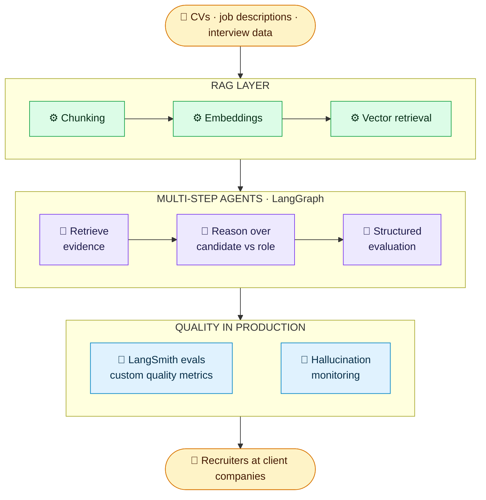
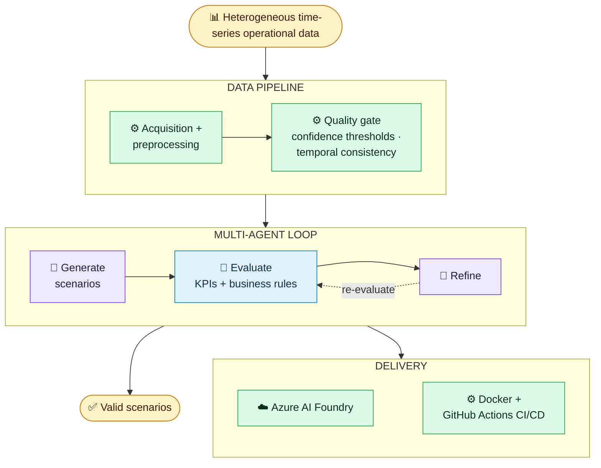

<h1 align="center">Hi, I'm Mouataz Bouazizi 👋</h1>
<h3 align="center">AI Engineer · Generative AI · LLMs · RAG · Multi-Agent Systems</h3>

  
  
  

---

## About me

I build **Generative AI systems that run in production** — not just demos.

I design and ship multi-agent LLM platforms end to end: RAG pipelines, agent orchestration with LangGraph, evaluation and monitoring, and deployment on Azure with Docker and CI/CD. My rule: **models propose, code verifies, humans approve** — and every claim of quality comes with an eval.

- 🔭 **Now:** GenAI Engineer at **Qodexia** — a multi-agent talent intelligence platform that evaluates candidates from CVs, job descriptions and interviews
- 🏭 **Before:** multi-agent supply chain optimization (SupplyzPRO), LLM + RAG for network operations data (Luceor), Transformer NLP research (Tagamuta Valley)
- 🎯 **Focus:** reliable LLM systems — grounding, structured outputs, hallucination control, evaluation
- 🎓 Telecommunications Engineering degree, ENIT (Tunis)
- 🌍 Arabic · English · French · German

## Featured projects

### 🧑‍💼 [Candidate Screening Agent](https://github.com/mouataz5/candidate-screening-agent)
LangGraph agent that screens CVs against a job: personal data is redacted before any model call, one assessor agent per criterion runs in parallel, every claim must cite a quote that code verifies, and only a human can decline a candidate. Durable human review, FastAPI with webhooks, and an eval against a fully automatic LLM: **0 qualified candidates rejected without a human (vs 2), 100% of invented evidence caught.**
`LangGraph` `interrupt() + SQLite checkpoints` `Pydantic` `BM25` `FastAPI` `Evals`

### 🎙️ [ExpenseVoice AI](https://github.com/mouataz5/expensevoice-ai) *(production, client project)*
A farm worker's voice note or invoice photo becomes a checked, approved, auditable expense. The LLM only fills fields; code validates its JSON, checks every number was actually spoken, routes the purchase to the right level of human review, and enforces approval rules. Eval: **risky extractions passed unflagged drop from 64% to 7%** versus trusting the model's confidence.
`Whisper` `LLM extraction` `Grounding checks` `PaddleOCR` `FastAPI` `React Native` `Celery`

### 🤖 [Project Management AI Agents](https://github.com/mouataz5/gestion-project-agents)
Six LangGraph agents that take a software project from spec to delivery: requirement analysis, task allocation, code review with a self-critique loop, meeting summaries, risk prediction and documentation.
`LangGraph` `Llama 3.3 70B` `Qdrant` `Parent–child RAG` `AST-aware code RAG` `Pydantic`

### 🦸 [Grounded Q&A Router](https://github.com/mouataz5/ai-engineer-assessment-mouataz-bouazizi)
FastAPI service that routes each question to a local dataset, a live API, or both — and answers only from retrieved context, with citations. 44 tests, resilient to source failures.
`FastAPI` `LLM routing` `SQLite FTS5 / BM25` `Grounded generation` `pytest`

### 💼 AI Job Application Agent *(in progress)*
Self-hosted platform that discovers AI/ML jobs, tailors a truthful ATS-optimized CV per role, and prepares applications — always stopping for human approval before submitting.
`FastAPI` `Next.js` `Celery` `PostgreSQL` `Playwright` `LLMs`

## Production work *(private code — architecture and results)*

### Qodexia · multi-agent candidate evaluation · *GenAI Engineer, 2025 – now*

I own the end-to-end build of a production multi-agent GenAI platform that automates candidate evaluation for recruiters at client companies.

| Result | |
|---|---|
| Screening time per candidate | **30 → 8 min** |
| Retrieval relevance | **+25%** |
| Inconsistent or erroneous outputs | **−30%** |

The core pattern, rebuilt from scratch in public: **[candidate-screening-agent](https://github.com/mouataz5/candidate-screening-agent)**.

### SupplyzPRO · multi-agent supply-chain scenarios · *AI Engineer, 2024 – 2025*

A multi-agent GenAI system that generates, evaluates and refines supply-chain optimization scenarios under business rules and operational constraints, fed by data pipelines with built-in quality gates.

| Result | |
|---|---|
| Scenarios passing all business rules | **72% → 94%** |
| Release time | **2 h → 25 min** |

🟪 AI agents · 🟩 code · 🟦 evaluation · 🟨 inputs and people

## Tech stack

**GenAI & LLMs**

**Vector databases**

**Backend, ML & MLOps**

---

<i>Open to AI Engineer / GenAI Engineer roles — on-site, remote or with relocation. Let's talk!</i>

